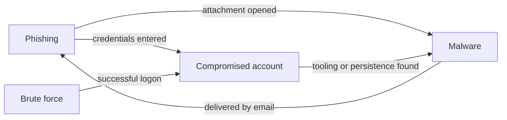

# Incident Response Playbooks


Step-by-step response playbooks for the three incident types a SOC handles most often. Each one follows the **NIST SP 800-61** incident response lifecycle (detection and analysis, containment, eradication, recovery, post-incident activity; Rev. 3 maps these onto the CSF 2.0 Respond and Recover functions) and is written to be used during a live incident: severity criteria up front, a decision flow, concrete actions, ready-to-run hunting queries and a checklist.

## Playbooks

| ID | Playbook | Covers | Key ATT&CK techniques |
|---|---|---|---|
| IR-PB-01 | [Phishing](playbooks/phishing.md) | Malicious links and attachments, credential harvesting, campaign scoping and purge | T1566.001, T1566.002, T1204, T1078 |
| IR-PB-02 | [Brute Force and Password Spraying](playbooks/brute-force.md) | Password guessing, spraying, credential stuffing, and checking whether any attempt succeeded | T1110.001, T1110.003, T1110.004, T1078 |
| IR-PB-03 | [Malware on an Endpoint](playbooks/malware.md) | Isolation, process-tree analysis, environment-wide scoping, credential exposure, reimage | T1204.002, T1059.001, T1053.005, T1003.001, T1486 |

Plus an [incident report template](templates/incident-report.md) used to close out every playbook, with timeline, IOC, ATT&CK and lessons-learned tables.

## How the playbooks fit together

Real incidents rarely stay in one box, so the playbooks hand off to each other:



## Every playbook has the same layout

So an analyst finds the same thing in the same place under pressure:

1. **Header:** playbook ID, owner, framework and related tools
2. **Overview** and **Triggers:** what starts this playbook
3. **ATT&CK mapping:** the techniques involved
4. **Severity:** criteria for Low, Medium, High and Critical
5. **Decision flow:** a diagram of the main decision points
6. **Detection and analysis, Containment, Eradication, Recovery, Post-incident activity:** the NIST phases, as numbered actions
7. **Hunting queries:** KQL (Microsoft Sentinel / Defender XDR) and Splunk SPL
8. **Analyst checklist:** to tick off in the ticket

[`scripts/check_playbooks.py`](scripts/check_playbooks.py) enforces this layout in CI. It fails the build if a playbook is missing a section, has sections out of order, has a malformed ATT&CK ID or no decision flow, or if any file links to a local page or heading that doesn't exist. Markdown style is checked with markdownlint.

```bash
python scripts/check_playbooks.py
```

## Part of a connected portfolio

These playbooks reference my other projects as the tools used during response:

- **[Detection Rules Library](https://github.com/iamafrozmohd/detection-rules):** the Sigma, Splunk and KQL detections that *trigger* these playbooks (encoded PowerShell, Office spawning shells, LSASS dumping, log clearing, new admins, brute-force hunting)
- **[IOC Enrichment Tool](https://github.com/iamafrozmohd/ioc-enricher):** the Python CLI used in the *analysis* steps to check IPs, domains, URLs and hashes against VirusTotal and AbuseIPDB
- **[DevSecOps Pipeline](https://github.com/iamafrozmohd/devsecops-pipeline):** the *prevention* side: catching vulnerable code, secrets and misconfigurations before deployment

## Notes

- Queries use placeholder indicators (`example` domains, documentation IP ranges, `<sha256>`). Table and index names vary between environments and need adjusting.
- Isolation, purge and reset actions should follow your organisation's approval process. Some, such as disabling an executive's account, usually need sign-off.
- References: [NIST SP 800-61](https://csrc.nist.gov/pubs/sp/800/61/r3/final), [MITRE ATT&CK](https://attack.mitre.org), [CISA incident response playbooks](https://www.cisa.gov/resources-tools/resources/federal-government-cybersecurity-incident-and-vulnerability-response-playbooks).

---
*Author: Afroz Mohammed · [LinkedIn](https://www.linkedin.com/in/iamafrozmohd) · CompTIA Security+ and CySA+*
