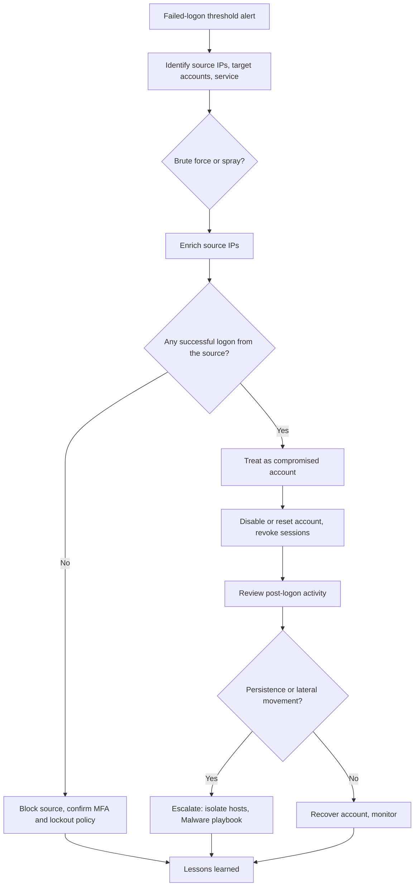

# Playbook: Brute Force and Password Spraying

| | |
|---|---|
| **Playbook ID** | IR-PB-02 |
| **Incident type** | Credential attack: brute force, password spraying, credential stuffing |
| **Primary owner** | SOC Tier 1 (triage), Tier 2 (compromise investigation) |
| **Framework** | NIST SP 800-61 incident response lifecycle |
| **Related tools** | [Brute-force hunt (SPL)](https://github.com/iamafrozmohd/detection-rules/blob/main/queries/splunk.md), [Brute-force hunt (KQL)](https://github.com/iamafrozmohd/detection-rules/blob/main/queries/kql.md), [IOC Enrichment Tool](https://github.com/iamafrozmohd/ioc-enricher) |

## Overview

Many failed logons from one source, or a few failed logons spread across many accounts. Failed attempts on their own are noise on any internet-facing service. **What matters is whether any attempt succeeded.** The core question of this playbook is: *did the attacker get in, and if so, what did they do next?*

| Pattern | What it looks like |
|---|---|
| **Brute force** | Many passwords tried against **one** account |
| **Password spraying** | One or two common passwords tried against **many** accounts, slowly, to stay under lockout thresholds |
| **Credential stuffing** | Username and password pairs leaked from other breaches, tried across many accounts |

## Triggers

- SIEM threshold alert: the brute-force and spraying hunt in the [detection rules library](https://github.com/iamafrozmohd/detection-rules)
- Account lockout spikes (Windows Event ID 4740) or a helpdesk spike in lockout calls
- Identity protection alerts (Entra ID "password spray", "unfamiliar sign-in properties", impossible travel)
- VPN, firewall or SSH logs showing repeated authentication failures

## ATT&CK mapping

| Technique | ID |
|---|---|
| Brute Force: Password Guessing | T1110.001 |
| Brute Force: Password Spraying | T1110.003 |
| Brute Force: Credential Stuffing | T1110.004 |
| Valid Accounts | T1078 |
| Create Account: Local Account (follow-on) | T1136.001 |
| Account Manipulation (follow-on) | T1098 |

## Severity

| Severity | Criteria |
|---|---|
| **Low** | Failures only, from known scanning infrastructure against an internet-facing service, with no successful logon |
| **Medium** | Sustained or targeted attempts (named employees, admin accounts) with no success, or significant lockouts affecting users |
| **High** | A **successful logon** from the attacking source, or a success shortly after a burst of failures |
| **Critical** | A privileged account compromised, or post-logon activity such as new accounts, admin group changes or lateral movement |

## Decision flow



## 1. Detection and analysis

1. **Build the picture:** source IPs, target accounts, the service targeted (VPN, Entra ID / Microsoft 365, RDP, SSH, OWA), the time window and the failure codes.
2. **Classify the pattern** using the table above. Many users per source points to spraying; many attempts on one user points to brute force.
3. **Read the failure reasons.** They tell you how far the attacker got:

   | Source | Code | Meaning |
   |---|---|---|
   | Windows Security log | 4625 | Failed logon (check `Status` / `SubStatus`: `0xC000006A` bad password, `0xC0000064` user doesn't exist) |
   | Windows Security log | 4771 / 4776 | Kerberos pre-auth failure / NTLM credential validation |
   | Windows Security log | 4740 | Account locked out |
   | Entra ID sign-in logs | 50126 | Invalid username or password |
   | Entra ID sign-in logs | 50053 | Account locked (Smart Lockout) |

   A wall of "user doesn't exist" failures means the attacker is guessing usernames. "Bad password" against valid accounts means they already have a good user list.
4. **Enrich the source IPs** with the [IOC Enrichment Tool](https://github.com/iamafrozmohd/ioc-enricher) to check AbuseIPDB reports and VirusTotal reputation, and note the hosting provider, VPN or Tor exit, and country.
5. **Search for success.** This is the most important step. Look for a successful logon (4624, or an Entra sign-in with `ResultType == 0`) from the same source IPs, or for the targeted accounts shortly after the failures (see the [hunting queries](#hunting-queries)). Also check whether MFA was challenged and whether it was satisfied or denied.

## 2. Containment

**No successful logon:**

- Block the source IPs or ranges at the firewall, VPN or conditional access (named locations).
- Confirm the targeted accounts have MFA enforced and that lockout or Smart Lockout settings are working.

**Successful logon (treat the account as compromised):**

1. Disable the account, or reset the password, and **revoke all sessions and refresh tokens**.
2. Review and remove any MFA methods the user didn't register.
3. If the account is privileged, escalate immediately and review every action it took since the first successful logon.
4. If a host was logged into interactively (RDP, SSH), isolate it through EDR.

## 3. Eradication

Hunt for what the attacker did after logging in, from the first successful logon onward:

- New local or domain accounts: [Local user account created](https://github.com/iamafrozmohd/detection-rules/blob/main/rules/local_user_account_created.yml) (4720)
- Privilege changes: [User added to local administrators](https://github.com/iamafrozmohd/detection-rules/blob/main/rules/user_added_to_local_admins.yml) (4732)
- Persistence: [Scheduled task created](https://github.com/iamafrozmohd/detection-rules/blob/main/rules/schtasks_create.yml)
- Covering tracks: [Security event log cleared](https://github.com/iamafrozmohd/detection-rules/blob/main/rules/security_log_cleared.yml) (1102)
- Mailbox access, inbox rules, OAuth app consents and file downloads for cloud accounts

Remove anything the attacker created. If malware or tooling is found, continue in the [Malware playbook](malware.md).

## 4. Recovery

- Re-enable the account after a password reset, MFA re-registration and the user's confirmation of recent activity.
- Keep the source blocks in place for an agreed period and review them before removal.
- Monitor the affected accounts for 14 days for sign-ins from new locations or devices.

## 5. Post-incident activity

- Complete the [incident report](../templates/incident-report.md).
- Find the root cause: an account without MFA, a legacy authentication protocol that bypasses MFA, an exposed RDP or SSH service, or a reused password.
- Recommend fixes: block legacy authentication, enforce MFA everywhere, put remote access behind VPN, and add banned-password lists.
- Tune the alert threshold if it was too noisy or too slow.

## Hunting queries

**Splunk (SPL):** a successful logon from a source that also failed many times (the critical check).

```spl
(sourcetype="WinEventLog:Security" OR sourcetype="XmlWinEventLog:Security") (EventCode=4625 OR EventCode=4624)
| eval outcome=if(EventCode=4624, "success", "failure")
| stats count(eval(outcome="failure")) AS failures
        count(eval(outcome="success")) AS successes
        values(TargetUserName) AS accounts
        min(_time) AS first_seen max(_time) AS last_seen
        BY IpAddress
| where failures >= 20 AND successes > 0
| convert ctime(first_seen) ctime(last_seen)
```

**KQL (Microsoft Sentinel, Entra ID):** spraying sources that also had a successful sign-in.

```kql
let window = 1d;
let sprayers =
    SigninLogs
    | where TimeGenerated > ago(window) and ResultType == "50126"
    | summarize failures = count(), users_tried = dcount(UserPrincipalName) by IPAddress
    | where users_tried >= 10;
SigninLogs
| where TimeGenerated > ago(window) and ResultType == "0"
| join kind=inner sprayers on IPAddress
| project TimeGenerated, UserPrincipalName, IPAddress, failures, users_tried,
          AppDisplayName, ConditionalAccessStatus, AuthenticationRequirement, Location
```

## Analyst checklist

- [ ] Source IPs, target accounts, service and time window recorded
- [ ] Pattern classified (brute force, spray or stuffing) and source IPs enriched
- [ ] Searched for successful logons from the sources and for the targeted accounts
- [ ] Sources blocked; MFA and lockout policy confirmed
- [ ] Any compromised account disabled or reset, with sessions revoked and MFA reviewed
- [ ] Post-logon activity hunted (new accounts, admin changes, persistence, log clearing)
- [ ] Root cause and hardening recommendations recorded in the incident report
