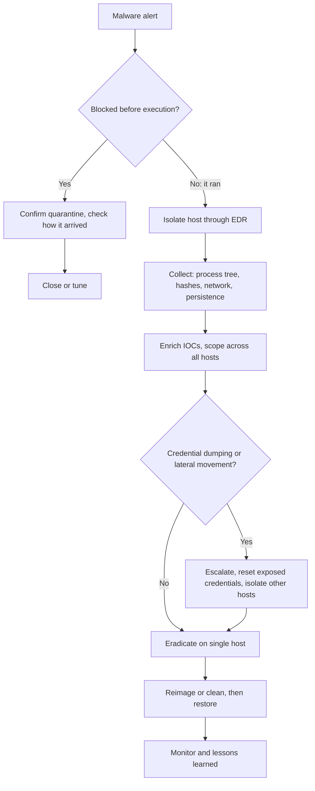

# Playbook: Malware on an Endpoint

| | |
|---|---|
| **Playbook ID** | IR-PB-03 |
| **Incident type** | Malware execution on a workstation or server (trojan, loader, infostealer, RAT, early-stage ransomware) |
| **Primary owner** | SOC Tier 1 (triage and isolation), Tier 2 / IR (scoping and eradication) |
| **Framework** | NIST SP 800-61 incident response lifecycle |
| **Related tools** | [Detection Rules](https://github.com/iamafrozmohd/detection-rules), [IOC Enrichment Tool](https://github.com/iamafrozmohd/ioc-enricher) |

## Overview

An EDR, antivirus or SIEM alert shows malicious code running on a host. Speed matters more here than in any other playbook: **isolate first, investigate second.** A contained host can be investigated calmly; an uncontained one can spread, steal credentials or start encrypting.

> **Ransomware warning:** if you see mass file renames, ransom notes or shadow copy deletion (`vssadmin delete shadows`), treat it as **Critical**, isolate every affected host immediately and escalate to the IR lead and management. Do not power hosts off; memory evidence is lost on shutdown.

## Triggers

- EDR detection (CrowdStrike Falcon, Microsoft Defender for Endpoint or similar) that was **not** fully blocked
- Antivirus detection where remediation failed or the file had already executed
- SIEM detections from the [detection rules library](https://github.com/iamafrozmohd/detection-rules):
  - [PowerShell with an encoded command](https://github.com/iamafrozmohd/detection-rules/blob/main/rules/powershell_encoded_command.yml) (T1059.001, T1027)
  - [Office application spawning a shell](https://github.com/iamafrozmohd/detection-rules/blob/main/rules/office_spawns_shell.yml) (T1204.002)
  - [Scheduled task created](https://github.com/iamafrozmohd/detection-rules/blob/main/rules/schtasks_create.yml) (T1053.005)
  - [LSASS memory dump via comsvcs](https://github.com/iamafrozmohd/detection-rules/blob/main/rules/lsass_dump_comsvcs.yml) (T1003.001)
  - [Security event log cleared](https://github.com/iamafrozmohd/detection-rules/blob/main/rules/security_log_cleared.yml) (T1070.001)
- Network alert for traffic to known command-and-control (C2) infrastructure
- Escalation from the [Phishing playbook](phishing.md) after a user opened an attachment

## ATT&CK mapping

| Technique | ID |
|---|---|
| User Execution: Malicious File | T1204.002 |
| Command and Scripting Interpreter: PowerShell | T1059.001 |
| Obfuscated Files or Information | T1027 |
| Scheduled Task/Job: Scheduled Task | T1053.005 |
| OS Credential Dumping: LSASS Memory | T1003.001 |
| Indicator Removal: Clear Windows Event Logs | T1070.001 |
| Application Layer Protocol (C2) | T1071 |
| Data Encrypted for Impact (ransomware) | T1486 |

## Severity

| Severity | Criteria |
|---|---|
| **Low** | Detected and fully blocked or quarantined before execution, with no further activity |
| **Medium** | Executed on one standard user's workstation, with no persistence, credential access or C2 seen |
| **High** | Persistence, C2 traffic or credential dumping seen, **or** a server or privileged user's machine affected |
| **Critical** | Several hosts, lateral movement, domain admin credentials exposed, or any sign of ransomware |

## Decision flow



## 1. Detection and analysis

1. **Read the alert:** host, user, file path, SHA-256, parent process and command line, and whether the EDR **blocked** it or only **detected** it.
2. **If the malware executed, isolate the host now** through EDR network containment (CrowdStrike "Network contain", Defender "Isolate device"). Isolation keeps the EDR connection open, so you can keep investigating.
3. **Collect evidence** from the EDR console or live response:
   - The full process tree: what launched it (Office, browser, `explorer.exe`, a script host?) and what it launched
   - File hashes, file paths and the original download or email source
   - Network connections: destination IPs, domains and ports
   - Persistence: Run keys, scheduled tasks, services, startup folder and WMI subscriptions
   - Memory capture if the IR team requests it (before any reboot)
4. **Enrich every indicator** (hashes, IPs, domains) with the [IOC Enrichment Tool](https://github.com/iamafrozmohd/ioc-enricher) and look up the malware family if the hash is known.
5. **Scope across the environment.** Search every host for the same hash, the same C2 domains and IPs, and the same persistence names (see the [hunting queries](#hunting-queries)). One infected host often means more.
6. **Check for credential access.** If [LSASS was dumped](https://github.com/iamafrozmohd/detection-rules/blob/main/rules/lsass_dump_comsvcs.yml) or an infostealer ran, assume every credential used on that host is exposed, including browser-saved passwords and session cookies.

## 2. Containment

1. Keep every affected host isolated.
2. Block the indicators everywhere: hashes in EDR, and C2 domains and IPs at the firewall, proxy and DNS.
3. Disable or reset the accounts that were logged into affected hosts, and **revoke their sessions** (stolen cookies bypass a password reset alone).
4. If credential dumping happened on a host where an admin had logged in, reset those privileged credentials as a priority.
5. If the infection came from an email, run the scoping and purge steps in the [Phishing playbook](phishing.md).

## 3. Eradication

- **Preferred: reimage** the host from a known-good image. Cleaning in place is only acceptable for low-severity, well-understood commodity malware with no persistence.
- If cleaning in place: remove the files, persistence entries (tasks, services, Run keys) and any accounts the malware created, then run a full EDR scan.
- Patch or fix the entry point: the exploited vulnerability, macro settings, or the user's local admin rights.

## 4. Recovery

- Restore user data only from backups taken **before** the first malicious activity, and scan restored files.
- Release the host from isolation only after reimage or verified cleanup and a clean EDR scan.
- Monitor the host and the affected accounts for 14 days for the same hashes, C2 traffic or persistence names.

## 5. Post-incident activity

- Complete the [incident report](../templates/incident-report.md) with a timeline from initial access to containment.
- Record dwell time (first malicious activity to detection) and time to contain. These are the metrics that matter.
- Feed back: new detections for any gaps found, EDR policy changes (block mode instead of detect-only), and macro or script execution hardening.
- Share the final IOCs with the threat intel platform and, where appropriate, with ISAC partners.

## Hunting queries

**KQL (Microsoft Defender XDR):** every host that ran the same file.

```kql
let bad_hash = "<sha256>";
DeviceProcessEvents
| where Timestamp > ago(30d)
| where SHA256 == bad_hash or InitiatingProcessSHA256 == bad_hash
| summarize first_seen = min(Timestamp), last_seen = max(Timestamp), executions = count()
    by DeviceName, AccountName, FolderPath
```

**KQL:** every host that talked to the C2 infrastructure.

```kql
DeviceNetworkEvents
| where Timestamp > ago(30d)
| where RemoteUrl has "c2-domain.example" or RemoteIP in ("198.51.100.10")
| summarize connections = count(), first_seen = min(Timestamp) by DeviceName, InitiatingProcessFileName, RemoteIP, RemoteUrl
```

**Splunk (SPL) with Sysmon:** process executions by hash (Sysmon Event ID 1).

```spl
index=sysmon EventCode=1 Hashes="*SHA256=<sha256>*"
| stats earliest(_time) as first_seen latest(_time) as last_seen count by host, User, Image, ParentImage
| convert ctime(first_seen) ctime(last_seen)
```

## Analyst checklist

- [ ] Alert reviewed: executed or blocked
- [ ] Host isolated through EDR (if executed)
- [ ] Process tree, hashes, network connections and persistence collected
- [ ] Indicators enriched and scoped across all hosts
- [ ] Indicators blocked in EDR, firewall, proxy and DNS
- [ ] Exposed credentials reset and sessions revoked
- [ ] Host reimaged or verified clean before release
- [ ] Incident report completed with dwell time and time to contain
