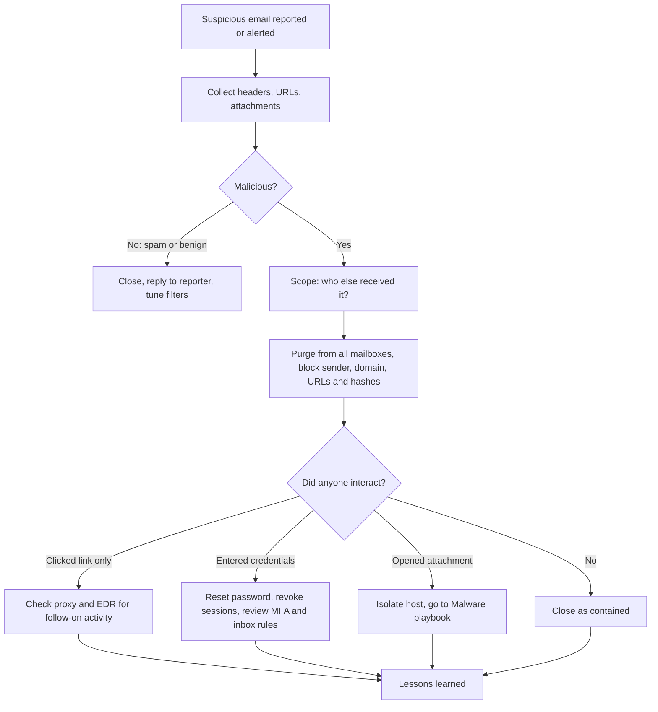

# Playbook: Phishing

| | |
|---|---|
| **Playbook ID** | IR-PB-01 |
| **Incident type** | Phishing / malicious email |
| **Primary owner** | SOC Tier 1 (triage), Tier 2 (containment and scoping) |
| **Framework** | NIST SP 800-61 incident response lifecycle |
| **Related tools** | [IOC Enrichment Tool](https://github.com/iamafrozmohd/ioc-enricher), [Detection Rules](https://github.com/iamafrozmohd/detection-rules) |

## Overview

A user reports a suspicious email, or the email gateway or a detection flags one. The goal is to decide quickly whether it is malicious, find **every** mailbox that received it, remove it, and find out whether anyone clicked, opened an attachment or entered credentials. Once a user has interacted with it, this playbook can hand off to [Malware](malware.md) or to a credential-compromise response.

## Triggers

- User report through the "Report phishing" button or the service desk
- Email security alert (Microsoft Defender for Office 365, Proofpoint, Mimecast or similar)
- SIEM alert: [Office application spawning a shell](https://github.com/iamafrozmohd/detection-rules/blob/main/rules/office_spawns_shell.yml) (T1566.001, T1204.002)
- Proxy, DNS or EDR alert for a newly registered or known-bad domain clicked from email

## ATT&CK mapping

| Technique | ID |
|---|---|
| Phishing: Spearphishing Attachment | T1566.001 |
| Phishing: Spearphishing Link | T1566.002 |
| User Execution: Malicious File | T1204.002 |
| User Execution: Malicious Link | T1204.001 |
| Valid Accounts (harvested credentials) | T1078 |

## Severity

| Severity | Criteria |
|---|---|
| **Low** | Spam or a generic phish. Nobody clicked, nothing executed, or it was blocked before delivery |
| **Medium** | Malicious email delivered to several users. A link was clicked but no credentials were entered and nothing executed |
| **High** | Credentials were entered, **or** an attachment executed on an endpoint |
| **Critical** | An executive, admin or finance account is compromised, there are signs of mailbox rules or MFA changes, or several hosts are affected |

## Decision flow



## 1. Detection and analysis

1. **Acknowledge the report** and open a ticket. Do not ask the user to forward the email as an attachment more than once; pull it from the mail platform instead if you can.
2. **Collect the evidence** without clicking anything:
   - Full message headers: `From`, `Reply-To`, `Return-Path`, `Received` chain, `Message-ID`
   - SPF, DKIM and DMARC results (`Authentication-Results` header)
   - Every URL (including the real targets behind shortened or redirect links) and any attachment hashes (SHA-256)
3. **Look for the usual red flags**: a display name that doesn't match the sending address, a `Reply-To` that differs from `From`, a lookalike domain (for example `rnicrosoft.com`), a newly registered domain, failed authentication, urgency, or payment or password requests.
4. **Enrich the indicators.** Defang them in the ticket and run them through the [IOC Enrichment Tool](https://github.com/iamafrozmohd/ioc-enricher):

   ```bash
   python -m ioc_enricher -f phish_iocs.txt -o phish_report.md
   ```

   Detonate unknown attachments and URLs in a sandbox only. Never open them on an analyst workstation.
5. **Make the call:** benign, spam, or malicious. If it's malicious, record the confidence level and your reasoning in the ticket.

## 2. Containment

1. **Scope the campaign.** Find every recipient by sender, subject, URL or attachment hash (see the [hunting queries](#hunting-queries)). Campaigns often rotate senders, so search on the URL domain and attachment hash too.
2. **Purge the message** from all mailboxes. In Microsoft 365 use Threat Explorer ("Soft delete"), or a Purview content search followed by `New-ComplianceSearchAction -Purge -PurgeType SoftDelete`.
3. **Block** the sender address or domain, the URLs and domains (email gateway, web proxy and DNS filtering) and the attachment hashes (EDR block list).
4. **Find out who interacted.** Use URL click events, proxy logs and EDR process events.
5. **For users who entered credentials:**
   - Reset the password and **revoke all active sessions and refresh tokens**
   - Review MFA methods for anything newly registered, and remove what the user doesn't recognise
   - Review inbox rules and forwarding (attackers commonly add rules that hide replies or forward mail out)
   - Review sign-in logs for logins from new locations or devices after the click time
6. **For users who opened an attachment:** isolate the host through EDR and continue in the [Malware playbook](malware.md).

## 3. Eradication

- Confirm the purge worked: re-run the scoping query and check that no copies remain in inboxes.
- Remove any malicious inbox rules, forwarding, OAuth app consents or MFA methods added by the attacker.
- If any host ran a payload, complete eradication through the [Malware playbook](malware.md).

## 4. Recovery

- Return affected accounts to the user only after the reset, session revocation and MFA review are complete.
- Watch affected accounts and hosts closely for 7 days: sign-ins, new inbox rules and EDR alerts.
- Remove temporary blocks that cause business impact only after a documented review.

## 5. Post-incident activity

- Complete the [incident report](../templates/incident-report.md) with the timeline, scope and actions taken.
- Thank the reporting user. Fast reporting is the behaviour you want to reinforce.
- Feed lessons back: new email gateway rules, detection tuning, and targeted awareness training for the lure used.
- Add the final IOCs to the threat intel platform or block lists, with an expiry date.

## Hunting queries

Table and index names differ between environments. Adjust them to your own.

**Microsoft Defender XDR / Sentinel (KQL):** every recipient of the campaign.

```kql
EmailEvents
| where Timestamp > ago(7d)
| where SenderFromAddress =~ "attacker@example.com" or Subject has "Invoice overdue"
| project Timestamp, RecipientEmailAddress, SenderFromAddress, Subject,
          DeliveryAction, DeliveryLocation, NetworkMessageId
```

**KQL:** who clicked through the link.

```kql
UrlClickEvents
| where Timestamp > ago(7d)
| where Url has "malicious-domain.example"
| project Timestamp, AccountUpn, Url, ActionType, IsClickedThrough, IPAddress
```

**Splunk (SPL):** hosts that reached the phishing domain through the proxy.

```spl
index=proxy url="*malicious-domain.example*"
| stats earliest(_time) as first_seen latest(_time) as last_seen count by src_ip, user, url
| convert ctime(first_seen) ctime(last_seen)
```

## Analyst checklist

- [ ] Headers, URLs and attachment hashes collected and defanged in the ticket
- [ ] Indicators enriched and a verdict recorded with reasoning
- [ ] All recipients identified and the message purged
- [ ] Sender, domains, URLs and hashes blocked
- [ ] Interacting users identified; credentials reset and sessions revoked where needed
- [ ] Inbox rules, forwarding and MFA methods reviewed for affected accounts
- [ ] Incident report completed and lessons learned recorded
